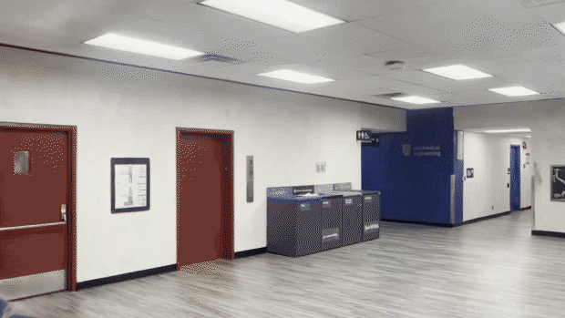
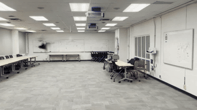
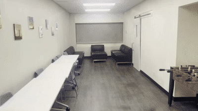
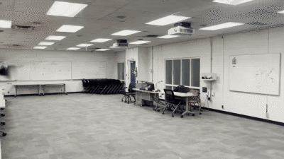
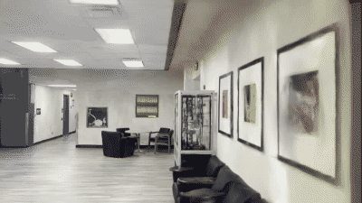
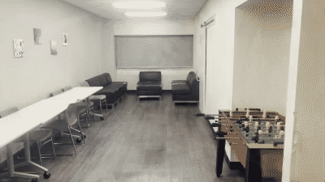
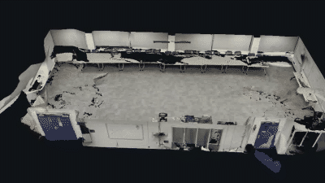
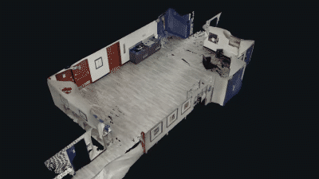
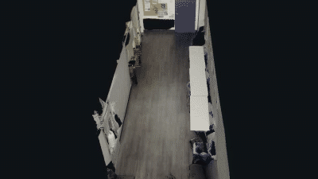
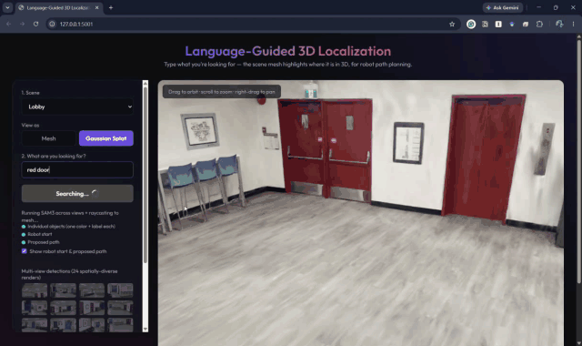

# TwinSplat

### Indoor digital twins you can walk through *and* measure

A single Gaussian-splatting reconstruction per room that is **photorealistic to look at**
and **centimetre-accurate to measure from** — rendered in real time, with a dense metric
surface extracted from the same trained model.

*Every frame above is synthesised by the model. None of it is captured footage.*

**Project showcase** · research code and full technical report are private — see
[Availability](#availability)

---

## The problem

Reconstructing a building interior from a handheld video is easy to do badly in one of two
ways, and the two failure modes pull against each other.

Standard 3D Gaussian Splatting renders beautifully, but its "surface" is a cloud of
floating blobs — treat it as geometry and it is off by tens of centimetres. You cannot
measure a wall on it, drive a robot through it, or check it against a floor plan.
Surface-constrained variants produce clean meshes but, on real capture data, their
rendering quality collapses by several decibels.

A digital twin needs both at once: the metric surface for as-built verification, the
appearance for inspection and walkthrough. Shipping two separate reconstructions means two
coordinate frames and no guarantee they agree.

**TwinSplat gets both from one model.**

## Results

Three indoor scenes — a classroom, a building lobby, and a lounge. Rendering is scored on
a **held-out test split**; geometry is scored against a **survey-grade LiDAR scan** of the
same room at a 5 cm threshold.

| Scene | PSNR ↑ | SSIM ↑ | LPIPS ↓ | Geometry F1@5 cm ↑ | Median surface error |
|---|---|---|---|---|---|
| classroom | 24.76 | 0.862 | 0.239 | **0.759** | **1.8 cm** |
| lobby | 26.36 | 0.928 | 0.129 | **0.616** | **2.3 cm** |
| lounge | 24.57 | 0.946 | 0.145 | **0.716** | **1.7 cm** |

Against a standard 3DGS baseline, appearance is equal or better on every scene while
geometry improves by **1.5×–8×**:

| Scene | PSNR (3DGS → TwinSplat) | **Geometry F1 (3DGS → TwinSplat)** |
|---|---|---|
| classroom | 24.07 → **24.76** | 0.192 → **0.759** |
| lobby | 26.26 → **26.36** | 0.473 → **0.616** |
| lounge | 23.95 → **24.57** | 0.076 → **0.716** |

The reconstruction comes out at **true metric scale** against the LiDAR, so a distance
measured on the mesh is a distance in the room.

### Multi-viewpoint rendering

<table>
<tr><td align="center"><b>classroom</b></td><td align="center"><b>lobby</b></td><td align="center"><b>lounge</b></td></tr>
<tr>
<td></td>
<td></td>
<td></td>
</tr>
</table>

### Zoom-in fidelity

A true **optical** zoom — the camera holds still and the field of view narrows, so this
probes reconstruction detail rather than just moving closer. Cable runs, chair frames,
signage and the contents of a glass display cabinet all survive.

<table>
<tr>
<td></td>
<td></td>
<td></td>
</tr>
</table>

### Geometry

The dense metric surface extracted from the same trained model, shown with the ceiling cut
away so you are looking into the room from above.

<table>
<tr>
<td></td>
<td></td>
<td></td>
</tr>
</table>

### Real-time rendering

Benchmarked at full capture resolution (1887×1061) on one NVIDIA H200, averaged over three
passes after warm-up:

| Scene | Gaussians | **Render FPS** | Peak GPU memory | Model size |
|---|---|---|---|---|
| classroom | 416 553 | **191** | 4.6 GB | 99 MB |
| lobby | 482 552 | **180** | 5.1 GB | 115 MB |
| lounge | 201 584 | **164** | 3.1 GB | 48 MB |

Comfortably real time at full resolution, which is what makes the interactive demo below
possible.

## Application: language-guided 3D localization

Because appearance and metric surface share one coordinate frame, the reconstruction
supports more than looking at it. This demo turns a free-text prompt into **individually
labelled 3D object instances** on the mesh, with a navigation target:

Type `"red door"` and the system runs text-grounded segmentation across two dozen
spatially-diverse rendered viewpoints, projects each detection onto the mesh, and
associates detections across views so that the same physical door seen from nine different
angles merges into **one** object carrying nine confirming views. Each instance gets its
own colour, bounding box and label, and a path is drawn from a start point to the nearest
one.

Measured output: 19 individually resolved chairs in the classroom, 8 separate doors in the
lobby, 3 sofas in the lounge. The viewer also switches between the metric mesh and the
Gaussian model rendered live in the browser.

This is the evidence that the reconstruction is accurate and complete enough for
**language-grounded, instance-level search and navigation targeting** — digital-twin
inspection, as-built verification, robot navigation simulation — not just visualisation.

## What I built

| | |
|---|---|
| **Representation** | Surface-constrained 3D Gaussian splatting, with a dense metric mesh extracted from the trained model by depth fusion |
| **Evaluation** | Full rendering suite (PSNR / SSIM / LPIPS) plus a geometry evaluator that robustly registers the prediction to LiDAR and reports accuracy, completeness, precision, recall and F1 |
| **Scale** | ~30 training runs across three scenes on 2× H200; per-scene models trained to 45–60k iterations at full capture resolution |
| **Systems work** | Brought a research CUDA rasterizer that no longer compiled up on a modern CUDA 12.x toolchain, removed a heavyweight dependency from the training path, extended the data loader for this dataset, and instrumented the renderer for frame-rate and memory benchmarking |
| **Application layer** | Flask + three.js viewer, text-grounded segmentation, mesh raycasting, and cross-view instance association |
| **Stack** | Python, PyTorch, CUDA/C++, COLMAP, Open3D, OpenCV, three.js |

## Status

Active research. The current line of work moves from image-only reconstruction toward
**fusing survey-grade terrestrial laser scanning with Gaussian splatting**, and toward
evaluating reconstructions in absolute surveyed coordinates against the dimensional
tolerances that construction practice actually specifies, rather than the alignment-fitted
metrics common in the computer-vision literature. A publication on this is in preparation.

## Availability

This repository is a **public showcase**. The research repository — the reconstruction
pipeline, the training and evaluation code, the ablation study, and the technical report —
is **private** while the work is being prepared for publication.

Happy to walk through the method, the ablations or the code in an interview, and to share
the full technical report with prospective employers or collaborators on request. Reach me
through my [GitHub profile](https://github.com/acharjee07).

## Credits

Built on open research in 3D Gaussian splatting and surface-constrained splatting, with
COLMAP for structure-from-motion and Open3D for geometry processing. The three indoor
scenes and their LiDAR ground truth come from the ASCE VIMS 2026 Datathon dataset.

Media in this repository is rendered output from the trained models. All rights reserved;
no licence is granted for reuse.
